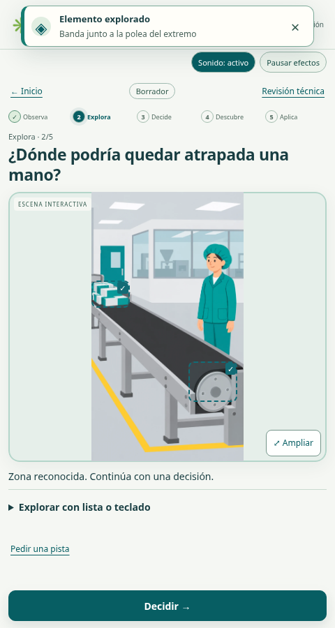
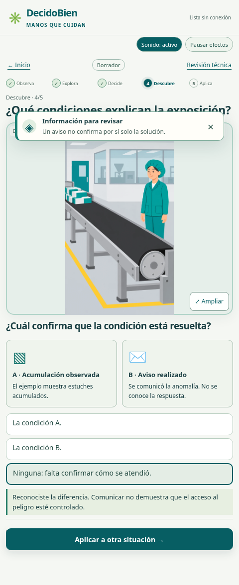

# Correa · Mejora audiovisual de la interfaz

[Ver demostración con sonido (MP4, 34 segundos)](demo/DecidoBien-correa-audiovisual.mp4)

La grabación muestra el navegador real y captura los sonidos de la aplicación. No tiene narración ni efectos añadidos posteriormente. Video H.264 y audio AAC; volumen deliberadamente moderado. La demostración sintetiza el recorrido para observar el ritmo; no representa la duración de una capacitación ni una prueba de retención.

## Qué responde a las acciones

- El toque genera un aro breve y cada elemento visitado conserva un contorno azul. Las marcas de exploración no certifican seguridad ni señalan elementos no visitados de antemano.
- Avisos transitorios con icono, texto y cierre indican información nueva o confirmación. Son avisos de la interfaz, no alarmas de equipo. No hay destellos rápidos o parpadeos permanentes.
- Cinco momentos muestran el avance sin premiar rapidez.
- Kuky usa expresiones del material original: atento, feliz y motivador. Sus intervenciones y gestos son breves y se pueden cerrar.
- Cuatro sonidos WAV locales distinguen selección, confirmación, información y cierre; el audio requiere activación explícita y puede silenciarse. Una nueva carga no inicia sonidos sin intervención del usuario.
- La comparación diferencia acumulación observada de aviso realizado: ninguna por sí sola demuestra que la condición esté resuelta. No representa dos estados técnicos validados de una máquina.

## Animaciones y rigor

**No se animó ningún proceso mecánico validado:** todavía no existe esa validación para este equipo. Las transiciones, gestos de Kuky, respuesta táctil, contornos y resaltados son recursos de interfaz. No giran piezas ni se desplazan estuches. La ilustración mantiene su condición de ejemplo pendiente de cotejo técnico.

Los resaltados explicativos aparecen después de confirmar o al solicitar una pista. El contorno de un elemento explorado solo responde al toque sobre ese mismo elemento.

## Controles y evaluación

Audio silenciable; efectos pausables; preferencia local de movimiento; respeto al movimiento reducido del sistema. Los controles estáticos y el teclado permiten completar la misión sin reproducir animaciones. Ninguna información depende solo del sonido.

La evaluación usa el mismo sonido neutral para cualquier selección y la misma confirmación para cualquier respuesta. No ofrece pistas ni efectos que distingan acierto y error durante el intento. Las respuestas confirmadas se conservan al recargar.

## Validaciones realizadas

Pruebas en Chromium con tamaños de teléfono y tablet, teclado, movimiento reducido, pausa/repetición, audio activado y silenciado, recuperación y modo offline. La prueba específica de medios verifica la reproducción de los cuatro recursos locales, el silencio tras desactivar el audio y su disponibilidad después de recargar sin red. El MP4 se comprobó con ffprobe y se verificó señal de audio no silenciosa.

Esto sigue siendo una versión revisable, sin aprobación técnica de contenido ni registro empresarial. La capacitación conserva el alcance de diseño de 30 minutos, sin esperas obligatorias. El efecto sobre la comprensión y retención requiere un piloto con participantes.
