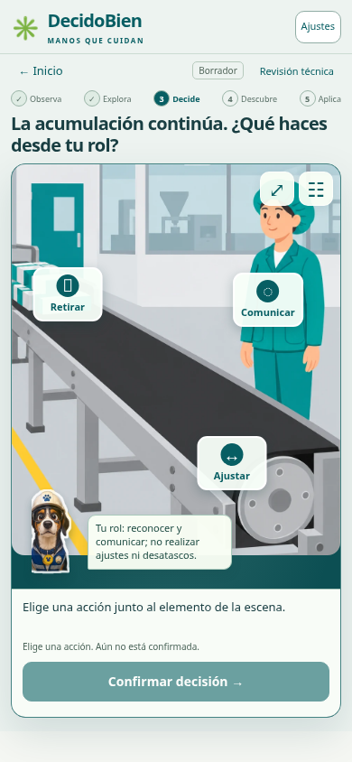
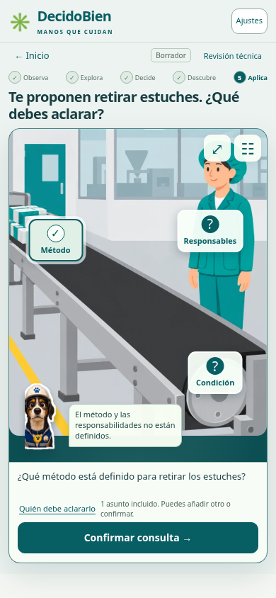

# Primera misión contextual — 2.4.0-review.2

Desarrollada desde `24bb4af`, en `implementation/correa-interactiva-2.4`. La referencia de composición guía el protagonismo de la escena, los controles integrados y Kuky; el equipo ilustrado sigue siendo conceptual y no está validado.

## Recorrido implementado

- **Inicio:** conserva «Manos que cuidan», la invitación y «Comenzar misión». La bienvenida explora tres elementos neutrales y siempre puede omitirse.
- **Observa:** contexto hipotético, rol disponible y escena central.
- **Explora:** tocar elementos; contorno tras el intento; pista voluntaria y lista accesible equivalente.
- **Decide:** las acciones Comunicar, Retirar y Ajustar están situadas junto a persona, materiales y banda. Seleccionarlas muestra la acción elegida; hace falta confirmar. Ninguna señal de corrección aparece antes.
- **Descubre:** la misma escena revela relaciones mediante focos y tres detalles. Un aviso no confirma una solución. Las decisiones que implican aproximación reciben explicación de exposición, sin lesión automática, culpa ni animación de una práctica insegura.
- **Aplica:** preparar una consulta sobre método, condiciones o responsables. Se pueden incluir o retirar asuntos. Basta uno para confirmar; no se obliga a pulsar todo. La consulta es para conversar con el relator: no se envía ni representa una corrección del equipo.
- **Evaluación:** tres preguntas sin pistas, Kuky o resaltados; confirmación neutra y recuperación de respuestas. Corrección al resultado.
- **Resultado:** comprensión del ejemplo, preguntas elegidas para conversar y revisión. No certifica aprobación o asistencia.

Se conserva el alcance de una sesión guiada de 30 minutos, incluyendo observación, conversación y evaluación. No se agregan tiempos de espera obligatorios ni premios por velocidad. La duración y retención reales requieren piloto.

## Composición y tecnología

La escena, Kuky original y la respuesta comparten una superficie. Se retiraron el panel de alternativas de práctica y la aplicación con alternativas repetidas bajo la imagen. El código común de dibujo se comparte con estudio y evaluación, sin duplicar una segunda misión. No se cambiaron el logo ni los archivos de Kuky.

SVG, HTML y CSS locales gestionan las zonas, estados y transiciones. No se añadió un motor ni una dependencia para tres regiones estáticas; los botones mantienen teclado y tecnologías de asistencia. No se realizó una migración de la PWA.

Los efectos de entrada, pulsación, foco y expresión de Kuky son **interfaz**. **No existe animación mecánica validada ni se simula movimiento de la banda, polea o materiales**. Los cambios de estado son selección, explicación, detalle explorado y consulta preparada. No habilitan una intervención real.

## Acceso y persistencia

Hay listas en diálogo equivalentes a todos los objetivos espaciales; la ruta completa funciona con teclado y movimiento reducido. Audio local, inicialmente apagado, silenciable. La primera descarga requiere conexión y luego todo el recorrido funciona offline. No se añade reproducción automática de audio ni videos externos.

La actualización desde la base `24bb4af` conserva respuestas y avance compatible. Los asuntos de consulta se guardan con el resto del recorrido. Una respuesta de la práctica anterior no se convierte automáticamente en una consulta preparada.

Ajustes incorpora el cierre explícito del recorrido en tablets compartidas: una confirmación permite borrar únicamente el progreso actual. Cancelar lo conserva. No se presenta como autenticación ni como borrado de datos heredados u otros sitios.

## Comprobaciones

- Contenido y modelo, incluida recuperación y rechazo de campos no válidos.
- Ruta completa con teclado, silencio/audio, movimiento reducido y offline.
- Vistas de 360×800, 390×844, 768×1024 y 1365×1000, sin desbordamiento horizontal.
- Decisión errónea con explicación; preparación, retirada y recuperación de asuntos de consulta.
- Evaluación sin corrección anticipada, respuestas confirmadas conservadas al recargar.
- Migraciones desde a590956, 844bc05 y 24bb4af: claves preservadas y ruta posterior offline.
- Cierre cancelado y confirmado, con preservación de claves ajenas.

Los scripts reproducibles están en README. La grabación final y su recibo de versión se entregan como evidencia del entorno de desarrollo. La velocidad de esa demostración no representa 30 minutos de sesión.

## Bloqueos y límites

La validación de equipo, tareas, accesos, controles, método, roles y fuentes sigue pendiente. No se crearon cinco misiones ficticias ni se reactivaron los casos reservados de laboratorio.

El Codespace del usuario no pudo verificarse: la conexión devuelve 403 del proxy. Una rama publicada no equivale a un despliegue en esa instancia. El protocolo de actualización desde Git está en README y mantiene la carpeta habitual y el puerto 4173.

No se han realizado pruebas con trabajadores ni con sus tablets físicas, Safari/iOS o lectores de pantalla reales. Los resultados de seguridad, correcciones y comprobaciones bloqueadas se detallan en [la auditoría](AUDITORIA_SEGURIDAD_2_4.md).
