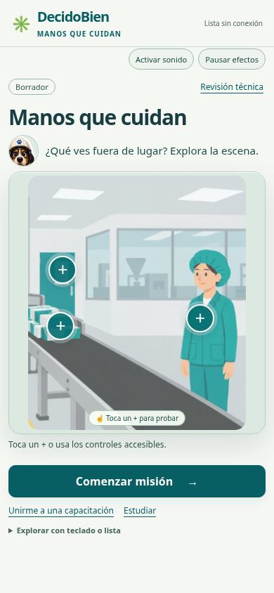

# Entrada interactiva de DecidoBien

[Ver la grabación desde la apertura hasta la misión, con audio (14 segundos)](demo/DecidoBien-entrada-interactiva.mp4)

La demostración comienza con sonido desactivado. El primer toque recibe respuesta visual en silencio; luego se activa el audio mediante el botón, se completa la bienvenida y se entra en la misión. El sonido corresponde a la salida real de la app, no a una banda sonora añadida. Las pausas del video son del recorrido de demostración, no esperas obligatorias del producto.

## Interacción de bienvenida

- Tres detalles neutrales: entorno, estuches y persona.
- Signos + y un ejemplo de toque comunican la posibilidad de explorar desde la apertura.
- Contorno y frase breve tras cada toque; lista y botones de teclado equivalentes.
- Al explorar los tres detalles, Kuky cambia de expresión e invita a continuar.
- No hay acierto, error ni puntaje; no se atribuye un peligro a la persona representada.
- La actividad puede omitirse: «Comenzar misión» está habilitado desde el primer momento.

El encuadre utiliza la ilustración existente y deja fuera el punto de peligro del ejercicio. No se desplazan materiales ni giran componentes: el acercamiento de entrada y las reacciones son exclusivamente recursos de interfaz. No existe una animación mecánica validada del equipo.

## Continuidad y límites

La bienvenida no incrementa intentos ni responde preguntas de la misión. El avance anterior se conserva; si se reabre una evaluación en curso, se mantiene su recuperación. «Inicio» permite volver a la bienvenida. Unirse a una sesión empresarial sigue siendo un acceso provisional, sin código ni asistencia implementados.

Audio opcional, controles de efectos, movimiento reducido del sistema y pausa disponibles. La exploración se entiende sin sonido. La revisión técnica y el estado de borrador permanecen disponibles fuera del protagonismo de la escena.

## Verificación

En Chromium, se comprobó que el título, la invitación, la escena y el botón principal están visibles sin desplazamiento en 390×844 y 360×800. Se probó tablet, entrada sin explorar, interacción directa sobre la escena, lista y teclado con movimiento reducido, y ausencia de errores JavaScript en esos recorridos. Las pruebas de misión, evaluación, sonido y modo offline continúan pasando.

El contenido sigue pendiente de validación técnica. Esta entrada no demuestra aprendizaje ni aprobación y no amplía el alcance de capacitación acordado.
