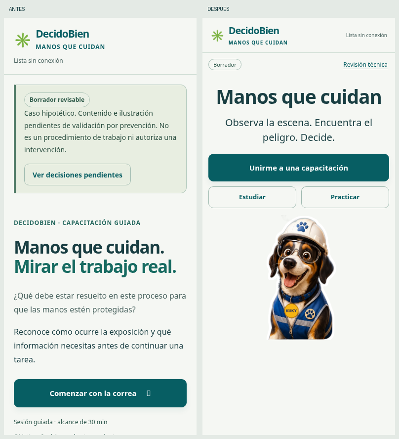
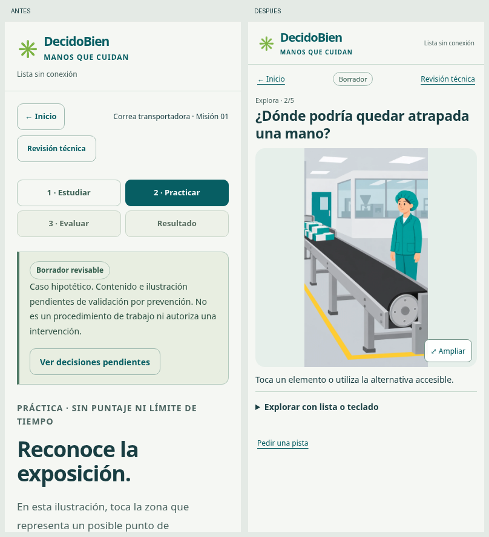

# Correa · Rediseño visual revisable

## Antes y después en móvil (390 × 844)

Capturas de la versión anterior c49aa3e y la nueva experiencia, recortadas al mismo viewport para comparar qué aparece sin desplazamiento.

## Lectura sustituida por actividad

| Antes | Ahora |
|---|---|
| Diagnóstico, alcance y pendientes al entrar | Tres accesos y un indicador breve; detalle en Revisión técnica. |
| Microlecciones y límites desplegados en bloque | Una observación por pantalla y explicaciones bajo demanda. |
| Instrucción y escena separadas por una página larga | Consigna breve junto a una ilustración ampliable. |
| Alternativas y resultado inmediato | Seleccionar → confirmar → descubrir los elementos de la explicación. |
| Explicación extensa sobre el proceso | Tres focos visuales que relacionan acceso, acumulación y controles pendientes. |
| Información insuficiente como respuesta general | Acción concreta desde el rol; información insuficiente cuando se propone una tarea no definida. |

La práctica no muestra el punto como respuesta antes del intento; una pista solo aparece al solicitarla o después de intentar. El estudio no adelanta ese punto antes del primer intento. Los resaltados posteriores no simulan funcionamiento mecánico y no validan la geometría del equipo real.

El recorrido visual es opcional, pausable, repetible y sustituible por botones estáticos. Con movimiento reducido no se reproduce. Ninguna animación impone una espera para completar tiempo.

La evaluación no ofrece pistas ni corrección durante las preguntas. Selección y confirmación son acciones separadas; solo la confirmación conserva la respuesta. La corrección se entrega al finalizar. Para salir se solicita una decisión explícita, preservando respuestas confirmadas.

El acceso «Unirme a una capacitación» conduce al caso con el relator en esta revisión. No se simula un ingreso por código empresarial ni una asistencia registrada. La ruta conserva los 30 minutos de diseño del módulo guiado completo, no acreditados por recorrer esta misión.

Contenido e ilustración siguen pendientes de validación técnica. Las preguntas se limitan a reconocer exposición, límites e información del proceso; no enseñan una intervención.
